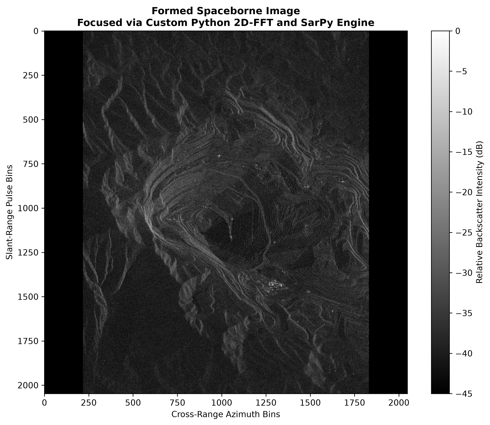

# Spaceborne SAR Image Formation: 2D Matched Filtering from Raw Phase History

A Python script designed to ingest raw, uncompressed spaceborne **Compensated Phase History Data (CPHD)** and synthesize a focused Single-Look Complex (SLC) image.

The targeted site for this analysis workspace is the Bingham Canyon Copper Mine in Utah, USA, captured via an Umbra Space X-Band Synthetic Aperture Radar (SAR) sensor executing a 0.5-Meter high-resolution Spotlight Mode Scan.



## Data Source & Acquisition Workflow

Satellite SAR data products are strictly categorized by their level of processing. Standard image files like Geocoded Ellipsoid Corrected (GEC) arrays are delivered as finished `.tif` rasters where the raw radar signals have already been focused, mapped, and filtered by ground station servers. CPHD files represent raw, un-focused signal records containing the original phase and amplitude returns captured directly by the spacecraft's sensor. 

Because these files are part of the open-access database hosted by the Umbra Open Data Program on Amazon S3, they can be pulled down natively through a terminal workspace. For an Ubuntu or Windows Subsystem for Linux (WSL) configuration, the native package manager can occasionally lack package candidate updates or run into secure path limitations. The optimal approach to establishing a working file ingestion pipeline is to deploy the official AWS CLI standalone binary package using the snap packaging engine with global system execution permissions, which automatically unzips and configures the environment path in one sequence.

```bash
# Install the official AWS CLI engine natively using classic security permissions
sudo snap install aws-cli --classic

# Verify the binary is successfully compiled and responding to system calls
aws --version

# Stream the raw uncompressed phase history archive (.cphd) down from the open cloud bucket
aws s3 cp --no-sign-request "s3://umbra-open-data-catalog/sar-data/tasks/Bingham Copper Mine/04371d76-7497-425e-b5bc-7206263b622a/2024-01-12-04-09-18_UMBRA-05/2024-01-12-04-09-18_UMBRA-05_CPHD.cphd" .
```

## Theoretical Framework & Radar Physics

Unlike an optical camera that opens a physical shutter and maps incoming light directly onto a geometric grid of pixels where spatial location is already explicitly established, a SAR sensor operates as an echo recorder. It transmits high-power microwave energy pulses and documents the time delay, amplitude, and phase angle of the reflections bouncing back from the earth. Consequently, the data is collected entirely within the time domain. The Fast Fourier Transform (FFT) serves as the primary digital lens in this pipeline, translating the abstract time-domain wave interactions directly into physical frequency-domain spatial coordinates.

The engineering of a SAR system exploits a unique mathematical concept known as separability. Because the physical mechanisms governing how a radar sensor maps the cross-track dimension (Range) are completely independent of how it maps the along-track dimension (Azimuth), the overall 2D image focus problem can be split into two isolated, sequential 1D operations. 

**Range Compression (`axis=0`)** focuses the data vertically down the matrix columns in a timeline called Fast-Time. Because the satellite transmits long, frequency-modulated *Linear FM Chirps*, overlapping reflections from targets at different distances blur together in raw memory. A 1D FFT acts as a matched filter, decoding the chirp modulation to collapse these smeared waveforms into sharp numerical peaks. This operation must run first in the Range-Doppler Algorithm; failing to isolate these distinct range bins beforehand would cause subsequent along-track operations to track completely unlocalized Doppler energy. 

**Azimuth Compression (`axis=1`)** focuses the data horizontally across rows over a longer timeline called Slow-Time. As the satellite travels along its orbital track, it continuously transmits pulses at a rigid Pulse Repetition Frequency (PRF). This relative motion generates a changing physical Doppler shift—a higher pitch as the spacecraft approaches a target and a lower pitch as it recedes. Executing a 1D FFT across this dimension maps these shifting frequency histories directly into precise horizontal cross-range coordinates, completing the 2D spatial grid.

**Frequency Centering and Scaling** transforms the focused output into a viewable map layout. The Discrete Fourier Transform natively outputs frequencies starting at 0Hz before wrapping into aliased negative frequencies, which would visually split the radar beam footprint in half. An `fftshift` operation swaps the matrix quadrants, centering the 0Hz baseline so terrain features align realistically. Finally, because the resulting array consists of complex numbers (I/Q channels), taking the absolute value isolates the raw backscatter magnitude. This data is normalized and converted to a logarithmic decibel (dB) scale via \20 * log10() to compress the massive dynamic range, elevating faint geological textures into viewable gray scales while preventing bright metallic reflections from blowing out the display.

